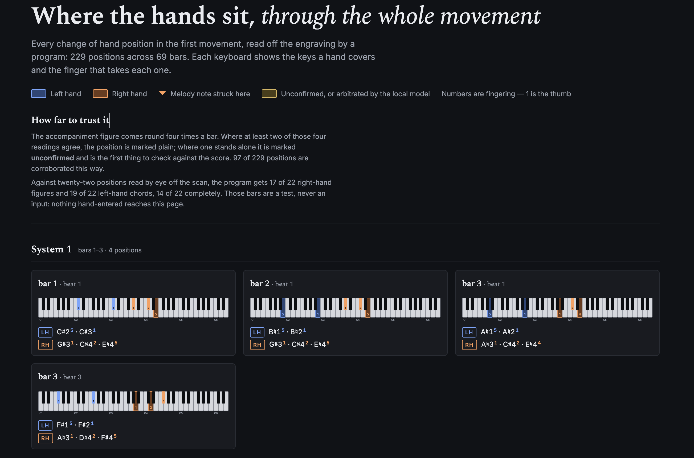

# Reading hand positions off a scanned piano score (or learning to play the piano for dummies)



`read_hand_positions.py` reads a scanned piano PDF and writes a page showing
where each hand sits, with fingering, at every change of position in the piece.
Nothing about the music is hard-coded: staves, barlines, noteheads and
accidentals are all found in the page images.

```bash
python3 read_hand_positions.py "Moonlight Sonata 1st Mov.pdf"
python3 read_hand_positions.py score.pdf --json positions.json
python3 read_hand_positions.py score.pdf --selftest
```

Needs `pypdf`, `pillow`, `numpy`, `scipy`.

## What it does

| stage | file | what it finds |
|---|---|---|
| pages | `omr_core.py` | the raster each PDF page actually draws |
| systems | `omr_core.py` | staff lines by ink density, paired into grand staves |
| bars | `omr_core.py` | barlines as columns spanning the whole grand staff |
| symbols | `omr_notes.py` | filled heads by their solid core, hollow heads by the hole in the ring, accidentals by the glyph to a head's left |
| texture | `omr_score.py` | columns of simultaneous notes, split into the accompaniment figure, the melody and the bass |
| positions | `positions.py` | one entry per beat, consecutive repeats merged |
| fingering | `fingering.py` | thumb on the lowest note of the figure, 5 held back for a melody note above it |
| page | `page.py` | the HTML |

Two rules do most of the work. A notehead outside the five lines has to ride on
a ledger line, which is what keeps the expression text from reading as a row of
whole notes. And in this engraving a natural is drawn 10px wide against a
sharp's 12–13, which separates them far more reliably than stroke geometry.

## Confidence

The accompaniment figure is played four times a bar, so each reading has three
chances to be corroborated. Positions backed by at least two beats are shown
plain; the rest are marked **unconfirmed** on the page and in the JSON.

`--selftest` compares the reading with twenty-two positions measured by hand
off the scan (`selftest.py`). Those bars are a yardstick only — nothing
hand-entered ever reaches the output.

## `--think`: a local model arbitrates

```bash
python3 read_hand_positions.py score.pdf --think=true
python3 read_hand_positions.py score.pdf --think=true --model gemma4:e4b --host http://localhost:11434
python3 read_hand_positions.py score.pdf --think=true --no-images --limit 10
```

Needs [Ollama](https://ollama.com) running with a vision model pulled. The
model name is matched loosely, so `Gemma4:e4b` finds `gemma4:e4b`. Thinking is
switched on for models that support it, with a token budget large enough for
the reasoning *and* the answer — otherwise the model spends the whole budget
reasoning and returns nothing. Answers are constrained by a JSON schema.

**The model is never asked to read music.** A small model is poor at telling a
notehead's staff degree from a picture, and letting it choose pitches freely
made the reading worse in testing. It is asked one question instead, about the
bars where exactly one beat disagrees with a reading the other beats
corroborate:

> Is the odd beat a mis-reading of the chord the other beats agree on, or does
> the harmony genuinely change inside the bar?

That is a judgement from context, which is what a language model is for. The
answer can only ever snap an outlier onto a reading the detector already made
twice; it cannot introduce a pitch that was never measured. Bars with no
corroborated majority are not sent at all, because there would be nothing safe
to snap to.

Expect roughly half a minute per arbitrated bar on consumer hardware.

